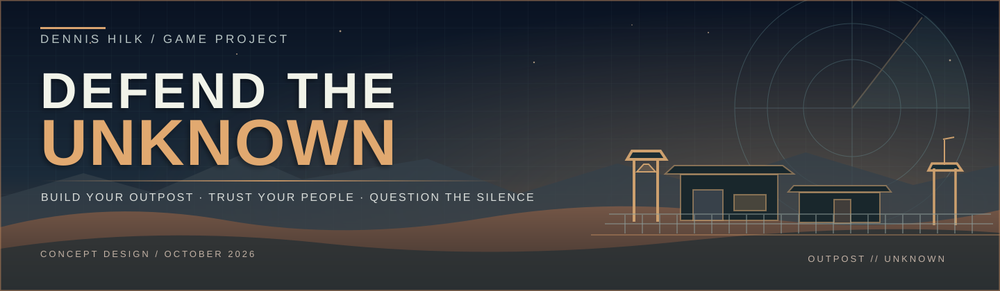

 

**A base to build. A perimeter to defend. A mystery beneath the sand.**

 

[-20203B?style=for-the-badge&logo=unrealengine&logoColor=white)](#technology-and-development)

[**Game Vision**](docs/GAME_VISION_EN.md) · [**Spielkonzept (DE)**](docs/SPIELKONZEPT_DE.md) · [**First Prototype**](docs/FIRST_PROTOTYPE.md) · [**Design Principles**](docs/DESIGN_PRINCIPLES.md)

---

## About the project

Hi, I'm **Dennis Hilk**. I started making little 3D worlds with Conitec's 3D GameStudio around 1999. Years later, I experimented with Unreal Engine and built a small military base with lights and motion detectors. With **DEFEND THE UNKNOWN**, I want to return to that idea — and see how far I can take it using Unreal Engine 5, ChatGPT, and OpenAI Codex.

I'm imagining a **single-player, first-person military base-building and defense game** with a tactical command view, believable personnel, vehicles, logistics, and a slow-burning mystery.

I don't want to build another ordinary wave shooter. I want to **live in the outpost I build**, know the people who defend it, make meaningful decisions, and wonder what's happening beyond the perimeter.

> **My design question:** What if I could build a Command & Conquer-style outpost, walk through it like an FPS, rely on soldiers who have real jobs, and slowly discover why the previous crew disappeared?

## The experience I am aiming for

| | What it means in my game |
| :-- | :-- |
| 🏜️ **My outpost** | I take command of a neglected desert military base and restore it at my own pace. |
| 🎮 **FPS + tactical view** | I explore on foot, use equipment and vehicles, and switch to a command/build view when needed. |
| 🪖 **People, not pawns** | Named soldiers have ranks, skills, assignments, routines, and room to gain experience. |
| 📻 **Orders with consequences** | I can give individual and squad orders. People act on information they actually have. |
| 🏗️ **Physical construction** | I plan buildings freely; engineers construct, repair, and dismantle them over time. |
| 🚙 **Logistics that matter** | Salvage, convoys, fuel, ammunition, workshops, and field repairs can all change the outcome. |
| 👁️ **Limited information** | Cameras only show their field of view. Radio silence means I may genuinely not know what's happening. |
| ❓ **The unknown** | At first the threats seem human. Strange incidents and a hidden underground facility slowly raise bigger questions. |

### A moment I want to experience

I'm underground with two soldiers, examining a dark corridor beneath my outpost. Up above, my personnel are going about their duties. Then the radio cracks:

> “Commander, unknown vehicles approaching the west gate.”

I ask for a status update. No answer from Harris. I can order a squad back, trust my deputy, or abandon the investigation. The world does **not** freeze just because I'm somewhere else.

That feeling — **command, uncertainty, responsibility, and attachment to my own base** — is the heart of the project.

## My non-negotiable design rules

- **No artificial rush at the beginning.** I can inspect the starting base, train, and prepare before deliberately launching the operation. Resources remain finite.
- **Pause and save.** I want to pause whenever I need to. Save/reload is part of the single-player design.
- **My soldiers have agency, not clairvoyance.** They maintain routines, respond to alarms, resume interrupted jobs, and report real observations. I remain in command.
- **Commands cost real time.** A convoy 14 km away doesn't teleport home because I called it back.
- **No busywork for the commander.** Quartermasters, mechanics, and deputies manage everyday tasks without requiring me to click every inventory item.
- **Failure matters but should be understandable.** Vehicles may be lost, repairs take time, poor orders have consequences, and the player can learn from them.
- **Simulation should be optional where sensible.** Fuel and ammunition rules can be configured; vehicle control is intended to support arcade and simulation styles.
- **Mystery is discovered, not force-fed.** No giant quest arrows over every stranger, no omniscient map, and no promise that every clue will be seen in one playthrough.

## The first playable experiment

I'm **not** trying to implement the entire design bible at once.

My first test should only prove that a small, coherent slice is fun:

1. Walk around a modest, worn desert outpost in first person.
2. Meet a few named soldiers and give them basic orders.
3. Switch to a tactical view and place one defensive structure.
4. Drive a simple jeep around a small local area.
5. Experience one readable hostile encounter and see the base respond.

**Success means the loop feels alive — not that every planned feature already exists.**

The first story mission I have in mind is simple: investigate a silent supply post, encounter a bullet-riddled abandoned vehicle along the way, bring back useful supplies, and learn what those materials can build. The mystery starts quietly.

➡️ [Read the prototype boundaries and acceptance ideas](docs/FIRST_PROTOTYPE.md)

## What may come later

I have a long list of ideas, **not a list of implemented features or promised release content**:

- Squads with leaders, guard orders, fire discipline, training, and individual loadouts.
- Salvaged vehicles, workshops, vehicle recovery, damage assessment, and specialist training.
- Radar, cameras, motion sensors, checkpoint networks, recon drones, and limited intelligence.
- Logistics convoys, captured outposts, traders, small settlements, and requests from HQ.
- Helicopter transport and later attack-helicopter support, with proper crew roles.
- Research through discovery, risky analysis, prototypes, and practical tests.
- A discoverable sealed bunker beneath the base and a mystery that unfolds through choices.
- Separate campaign and build-only sandbox modes.

➡️ [Read the extended game vision](docs/GAME_VISION_EN.md)

## Technology and development

My **current target** is Unreal Engine 5. I intend to experiment with ChatGPT, OpenAI Codex, and suitable Unreal Editor integrations, including MCP-style tools where they are practical. I will document what the tools can actually achieve, what requires manual intervention, and what fails.

My main development machine runs **Arch Linux** with an AMD Ryzen 7 5800X3D, Radeon RX 9060 XT 16 GB, and 32 GB RAM. Because I am also investigating GPU stability on Linux, I will start with a **deliberately small test**, not an enormous world.

**No UE5 project, executable, release, or verified Codex-to-Unreal workflow is included yet.** The documentation is the starting point, not evidence of a working game.

## Documentation

| Document | Purpose |
| :-- | :-- |
| [Game Vision (English)](docs/GAME_VISION_EN.md) | Setting, command, world systems, progression, mystery, and long-term ideas. |
| [Spielkonzept (Deutsch)](docs/SPIELKONZEPT_DE.md) | Ausführliche Spielvision auf Deutsch, in meiner eigenen Perspektive. |
| [First Prototype](docs/FIRST_PROTOTYPE.md) | A very small scope with explicit non-goals and testable outcomes. |
| [Design Principles](docs/DESIGN_PRINCIPLES.md) | The rules I want to use when deciding what belongs in the game. |

## Project status

**Concept and design stage — started October 26, 2026.** This repository is currently a public home for the idea and the evolving design notes. Screenshots, gameplay, AI autonomy results, and release dates will only be claimed when I actually have evidence for them.

I'm keeping the repository public so the concept and its development history are visible. **Public visibility is not a software license.** I have not chosen an open-source license yet; until that changes, no reuse permissions beyond applicable law should be assumed.

## About me

I'm **Dennis Hilk**, a Linux enthusiast and hobby developer from East Frisia, Germany. I like systems-driven games, believable military hardware, interactive worlds, and mysteries that reward curiosity.

- 🌐 [dennishilk.com](https://www.dennishilk.com)
- 🐙 [GitHub · dennishilk](https://github.com/dennishilk)

---

**DEFEND THE UNKNOWN**

*Build your outpost. Trust your people. Question the silence.*

An independent personal game-development experiment by Dennis Hilk. Unreal Engine is a trademark of Epic Games, Inc.; this project is not affiliated with Epic Games.

